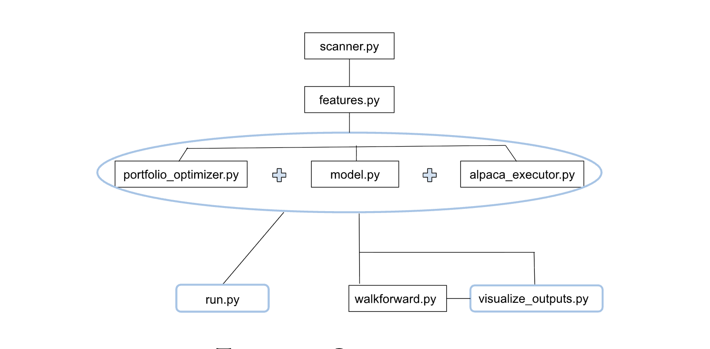
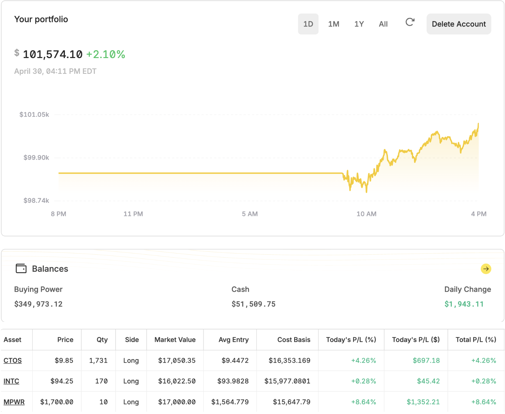
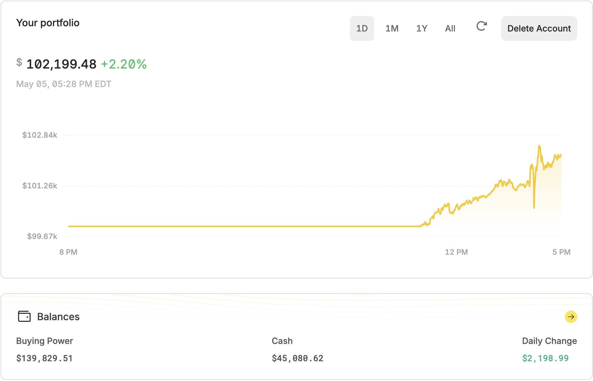
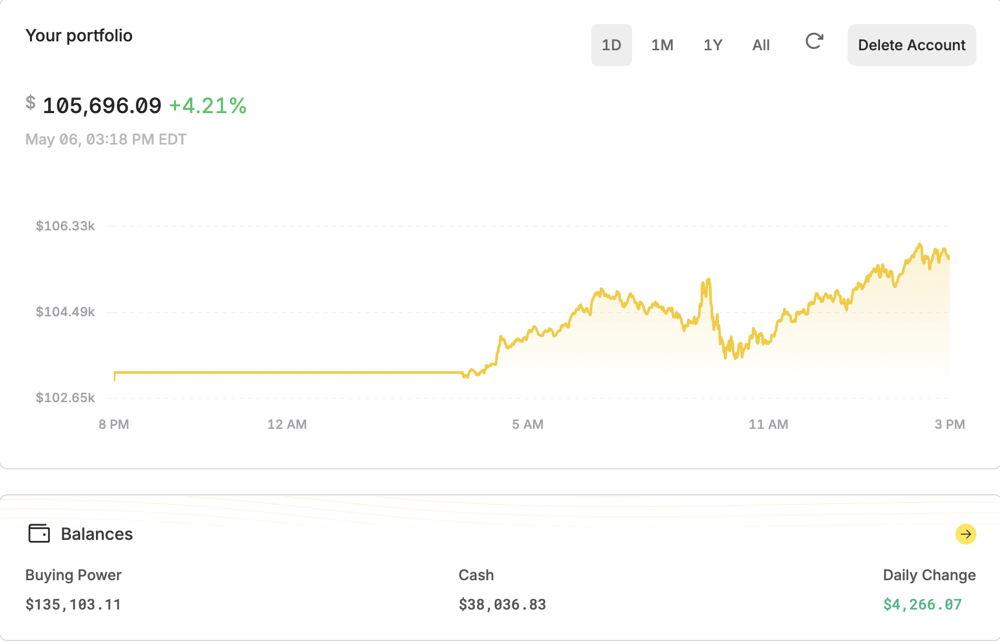
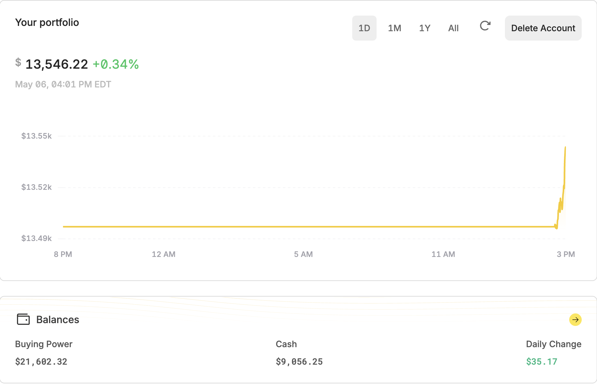
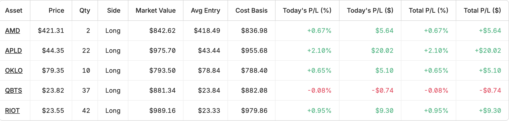

# trade-bot

A high-conviction, regime-aware algorithmic trading system designed to identify and execute **momentum continuation and breakout trades** with a focus on:

- Maximum return
- Convex upside capture
- High Sharpe optimization
- Strict risk management

This system integrates **data ingestion, feature engineering, machine learning, portfolio optimization, and execution** into a unified pipeline powered by the Alpaca API. Visit <a href="https://alpaca.markets/algotrading">alpaca.markets/algotrading</a> for a free account.

---

## 🧠 Core Philosophy

The system  integrates automated trading universe selection, feature engineering, probabilistic regime detection, and portfolio optimization to dynamically allocate capital between bullish and bearish exposures. A hybrid architecture combining statistical modeling and reinforcement learning enforces strict regime-consistent constraints, reducing exposure to adverse market conditions.

Which means this system:
- Trades **only the best opportunities**
- Focuses on **explosive upside setups**
- Concentrates capital into **top-ranked symbols**
- Uses **probability + expected value** for decision-making
- Minimizes drawdowns via strict execution controls

---

## 🏗️ System Architecture

<!-- markdownlint-disable MD033 -->
<!-- Image carousel / gallery (README-friendly) -->
<p align="center">
  <a href="images/sys-arch.png"></a>
</p>
<!-- markdownlint-enable MD033 -->

---

## ⚙️ Key Features

### 📊 Signal Generation
- Breakout detection (`close > previous high`)
- Momentum confirmation:
  - RSI
  - MACD crossovers
  - Stochastic RSI
- Volume & liquidity filtering

---

### 🤖 Machine Learning
- Ensemble models (Gradient Boosting + Random Forest)
- Probability-based trade selection
- Threshold optimization
- Regime-aware routing

---

### 🧠 Regime Awareness
Market states:
- **TREND_RISK_ON**
- **VOLATILE_RISK_ON**
- **CHOP_NEUTRAL**
- **DEFENSIVE_RISK_OFF**

Adjusts:
- Exposure
- Position sizing
- Trade thresholds

---

### 💰 Portfolio Optimization
- Max Sharpe + max return targeting
- Convex position sizing
- Kelly-style adjustments
- Risk penalties for:
  - Volatility
  - Bear conditions
  - Reversal signals

---

### ⚡ Execution Engine
Production safeguards:
- Market-hours guard
- Daily loss kill switch
- Cash buffer enforcement
- Max position sizing
- Spread / liquidity checks
- Slippage tracking

---

## 📁 Outputs

All outputs are stored in `daily_system_outputs/`.

### Terminal Output
<!-- markdownlint-disable MD033 -->
<!-- Image carousel / gallery (README-friendly) -->
<p align="center">
  <a href="images/ui/img3.png"></a>
</p>
<!-- markdownlint-enable MD033 -->

### daily_system_outputs/daily_features.csv
<!-- Image carousel / gallery (README-friendly) -->
<p align="center">
  <a href="images/ui/data.png"></a>
</p>
<!-- markdownlint-enable MD033 -->

Key files:
- `daily_features.csv`
- `regime_predictions.csv`
- `regime_actions.csv`
- `portfolio_targets.csv`
- `rebalance_orders.csv`
- `exit_orders.csv`

---

## 💰 Results

### Day 1:

This system was able to produce more than $1,000 on its first day of trading.
<!-- markdownlint-disable MD033 -->
<!-- Image carousel / gallery (README-friendly) -->
<p align="center">
  <a href="images/img6.png"></a>
</p>
<!-- markdownlint-enable MD033 -->

---

### Day 2:

I had to reset to a fresh account ($100,000) since I was developing this on an account associated with a different trading system. Despite this I was still was able to make well over $2,000 today. (Not a fluke)

<!-- markdownlint-disable MD033 -->
<!-- Image carousel / gallery (README-friendly) -->
<p align="center">
  <a href="images/img5.png"></a>
</p>
<!-- markdownlint-enable MD033 -->
<!-- Image carousel / gallery (README-friendly) -->
<p align="center">
  <a href="images/img4.png"></a>
</p>
<!-- markdownlint-enable MD033 -->


---

### Day 3:

The system continued to let good trades develop and scaled into runners. Haven't seen any concerning results as of yet.

<!-- markdownlint-disable MD033 -->
<!-- Image carousel / gallery (README-friendly) -->
<p align="center">
  <a href="images/may-06.png"></a>
</p>
<!-- markdownlint-enable MD033 -->
<!-- Image carousel / gallery (README-friendly) -->
<p align="center">
  <a href="images/may-06-2.png"></a>
</p>
<!-- markdownlint-enable MD033 -->

>**UPDATE**<br>
I was able to secure funding for an alpaca account with $13,000 as the initial investment in this system. So I redeveloped the program to paper trade with 13k instead of 100k. I plan on paper trading with the 13k initially to ensure the system still works as expected despite the reduced portfolio equity.

I’ve set up the 13k account for live trading.

<!-- markdownlint-disable MD033 -->
<!-- Image carousel / gallery (README-friendly) -->
<p align="center">
  <a href="images/13k.png"></a>
</p>
<!-- markdownlint-enable MD033 --><!-- Image carousel / gallery (README-friendly) -->
<p align="center">
  <a href="images/13k-2.png"></a>
</p>

Despite this run being considerably less impressive than the rest due to the drastically reduced portfolio equity, results still prove to be favorable with the model still accurately predicting positive momentum in stock price. I should also mention this update only traded for about 30 minutes before markets closed today.

<!-- markdownlint-enable MD033 -->


---

## 🚀 Usage

### 1. Install Dependencies

```bash
pip install -r file.txt
```
### 2. Configure Environment

Create a .env file and populate your Alpaca API keys.
```bash
APCA_API_KEY_ID=your_alpaca_key
APCA_API_SECRET_KEY=your_alpaca_secret_key
```
### 3. Run the stock scanner first.
```bash
python scanner.py
```
### 4. Feature Engineering.
```bash
python features.py
```
### 5. Run the rl model.
```bash
python model.py
```
### 6. Run the walkforward analysis.
```bash
python walkforward.py
```
### 7. Visualize generated model performance.
```bash
python visualize_outputs.py
```
### 8. Run the trading system.
```bash
python run.py
```
> For Live Execution use the API keys associated with the Alpaca live account. (Use Carefully)

---

## 📦 Project Structure

### Core Components

- **Scanner** (scanner.py)
  - Builds dynamic universe (S&P 500 + NASDAQ)
  - Identifies breakout + momentum candidates

- **Feature Engineering** (features.py)
  - Generates indicators:
    - RSI, MACD, Bollinger Bands
    - SMA (5/20/50/200)
    - Volatility, ATR, volume metrics
    - Regime features (SPY / QQQ / VIXY)

- **Model** (model.py)
  - Supervised continuation model
  - Outputs:
    - Trade probabilities
    - Target weights
    - Regime-aware actions

- **Walk-Forward Simulation** (walkforward.py)
  - Validates strategy using rolling windows
  - Focuses on:
    - Explosive returns
    - Convex risk-reward
    - Capital preservation

- **Portfolio Optimizer** (portfolio_optimizer.py)
  - Maximizes:
    - Expected return
    - Sharpe ratio
  - Penalizes:
    - Volatility
    - Reversal risk
    - Weak confidence

- **Execution Engine** (alpaca_executor.py / run.py)
  - Production-grade Alpaca executor
  - Features:
    - Sell-first logic
    - Cash buffer protection
    - Kill switch
    - Pre-trade sanity checks
    - Slippage tracking

- **Streaming Executor** (Continuous - run.py)
  - Runs continuously
  - Integrates:
    - Scanner
    - Execution
    - Portfolio updates

- **Orchestrator** (run.py)
  - End-to-end pipeline runner:
    - Data → Features → Model → Portfolio → Orders

- **Visualization** (visualize_outputs.py)
  - Generates:
    - Feature importance plots
    - Threshold optimization charts
    - Trade distributions


---

## ⚠️ Risk Management

### The system enforces:

- Max daily loss % threshold
- Absolute dollar threshold
- Cash buffer requirements
- Max position limits
- Exposure caps by regime
- Kill switch (auto stop trading)

### 📈 Strategy Characteristics
- Property Behavior 
- Trade Frequency
- Low Win Rate Target ~60% Focus
- High-conviction trades
- Holding Period
- Multi-day Edge
- Momentum + continuation
- Risk Style: Convex / asymmetric

### 🧪 Research Notes
- Uses strictly causal features
- Avoids data leakage
- Walk-forward validated
- Designed for real execution constraints

--- 

> ***DISCLAIMER*** <br>
> This system is for research and educational purposes only. Trading involves substantial risk. Use paper trading before deploying real capital and trade at your own risk.