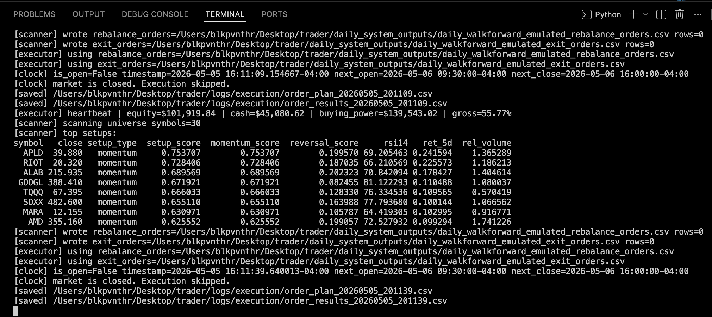
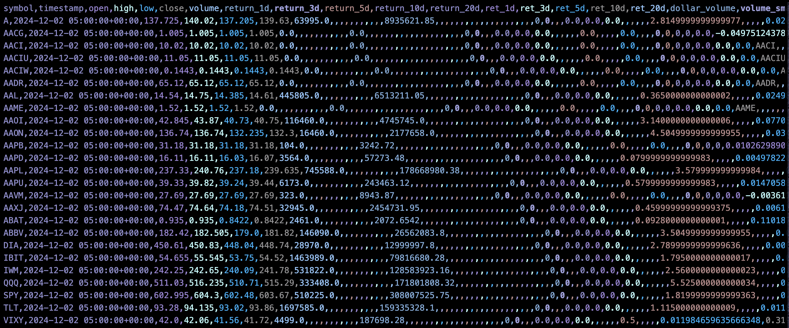
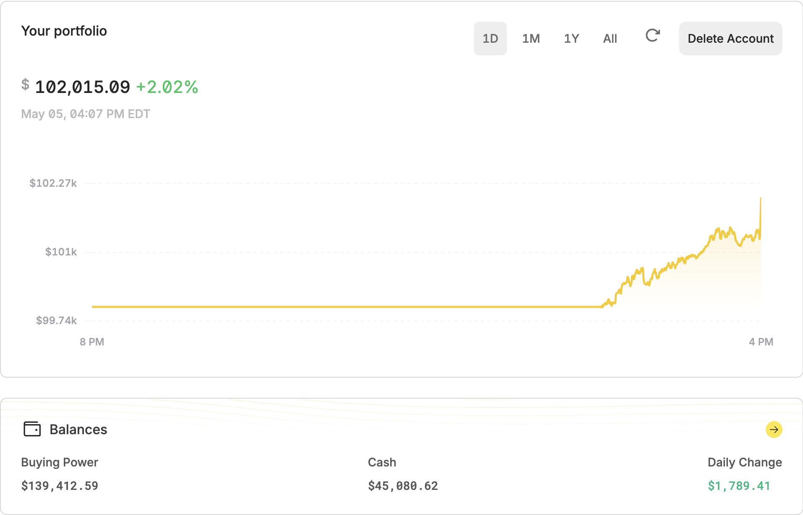
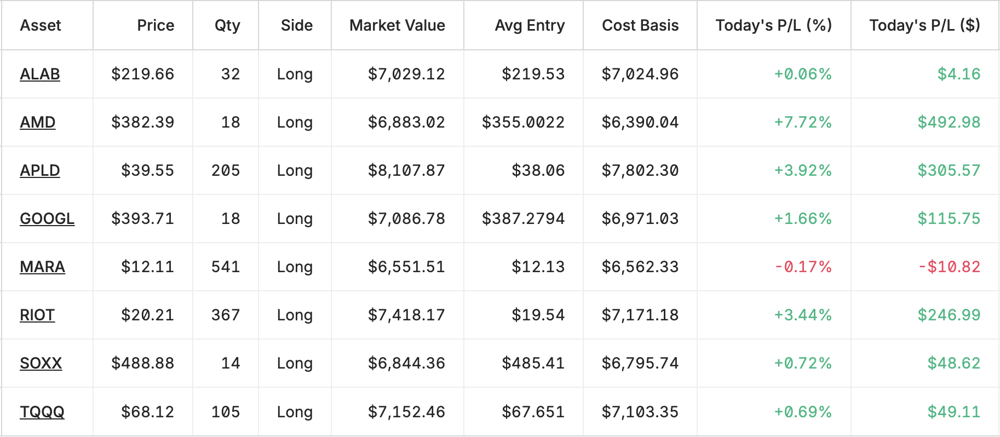

# trade-bot

A high-conviction, regime-aware algorithmic trading system designed to identify and execute **momentum continuation and breakout trades** with a focus on:

- Maximum return
- Convex upside capture
- High Sharpe optimization
- Strict risk management

This system integrates **data ingestion, feature engineering, machine learning, portfolio optimization, and execution** into a unified pipeline powered by the Alpaca API.

---

## 🧠 Core Philosophy

This system is **not** designed to trade frequently.

Instead, it:
- Trades **only the best opportunities**
- Focuses on **explosive upside setups**
- Concentrates capital into **top-ranked symbols**
- Uses **probability + expected value** for decision-making
- Minimizes drawdowns via strict execution controls

---

## 🏗️ System Architecture

<!-- markdownlint-disable MD033 -->
<!-- Image carousel / gallery (README-friendly) -->
<p align="center">
  <a href="images/sys-arch.png"></a>
</p>
<!-- markdownlint-enable MD033 -->

---

## ⚙️ Key Features

### 📊 Signal Generation
- Breakout detection (`close > previous high`)
- Momentum confirmation:
  - RSI
  - MACD crossovers
  - Stochastic RSI
- Volume & liquidity filtering

---

### 🤖 Machine Learning
- Ensemble models (Gradient Boosting + Random Forest)
- Probability-based trade selection
- Threshold optimization
- Regime-aware routing

---

### 🧠 Regime Awareness
Market states:
- **TREND_RISK_ON**
- **VOLATILE_RISK_ON**
- **CHOP_NEUTRAL**
- **DEFENSIVE_RISK_OFF**

Adjusts:
- Exposure
- Position sizing
- Trade thresholds

---

### 💰 Portfolio Optimization
- Max Sharpe + max return targeting
- Convex position sizing
- Kelly-style adjustments
- Risk penalties for:
  - Volatility
  - Bear conditions
  - Reversal signals

---

### ⚡ Execution Engine
Production safeguards:
- Market-hours guard
- Daily loss kill switch
- Cash buffer enforcement
- Max position sizing
- Spread / liquidity checks
- Slippage tracking

---

## 📁 Outputs

All outputs are stored in:

### daily_system_outputs/
<!-- markdownlint-disable MD033 -->
<!-- Image carousel / gallery (README-friendly) -->
<p align="center">
  <a href="images/ui/img3.png"></a>
</p>
<!-- markdownlint-enable MD033 -->

### daily_system_outputs/daily_features.csv
<!-- Image carousel / gallery (README-friendly) -->
<p align="center">
  <a href="images/ui/data.png"></a>
</p>
<!-- markdownlint-enable MD033 -->
<!-- markdownlint-enable MD033 -->

Key files:
- `daily_features.csv`
- `regime_predictions.csv`
- `regime_actions.csv`
- `portfolio_targets.csv`
- `rebalance_orders.csv`
- `exit_orders.csv`

---

## 💰 Results

### Day 1:

This system was able to produce over $2,000 on its first day of trading.

<!-- markdownlint-disable MD033 -->
<!-- Image carousel / gallery (README-friendly) -->
<p align="center">
  <a href="images/ui/img.png"></a>
</p>
<!-- markdownlint-enable MD033 -->
<!-- Image carousel / gallery (README-friendly) -->
<p align="center">
  <a href="images/ui/img4.png"></a>
</p>
<!-- markdownlint-enable MD033 -->


---

## 🚀 Usage

### 1. Install Dependencies

```bash
pip install -r file.txt
```
2. Configure Environment

Create a .env file:
```bash
APCA_API_KEY_ID=your_key
APCA_API_SECRET_KEY=your_secret
```
3. Run Full Pipeline (Dry Run)
```bash
python run_daily_system_walkforward_emulated.py
```
4. Execute Trades (Paper)
```bash
python run_daily_system_walkforward_emulated.py --execute
```
5. Live Execution (Use Carefully)
```bash
python alpaca_executor.py --live
```
---

# ⚠️ Risk Management

### The system enforces:

Max daily loss:
- % threshold
- absolute dollar threshold
- Cash buffer requirements
- Max position limits
- Exposure caps by regime
- Kill switch (auto stop trading)

### 📈 Strategy Characteristics
- Property Behavior 
- Trade Frequency
- Low Win Rate Target ~60% Focus
- High-conviction trades
- Holding Period
- Multi-day Edge
- Momentum + continuation
- Risk Style: Convex / asymmetric

### 🧪 Research Notes
- Uses strictly causal features
- Avoids data leakage
- Walk-forward validated
- Designed for real execution constraints

--- 

# 🛑 Disclaimer

This system is for research and educational purposes only.

Trading involves substantial risk. Use paper trading before deploying real capital.